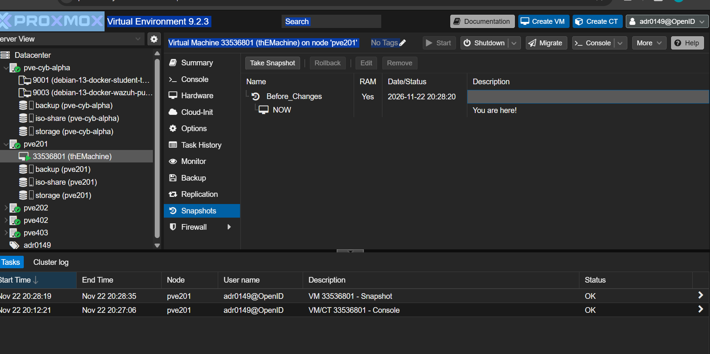
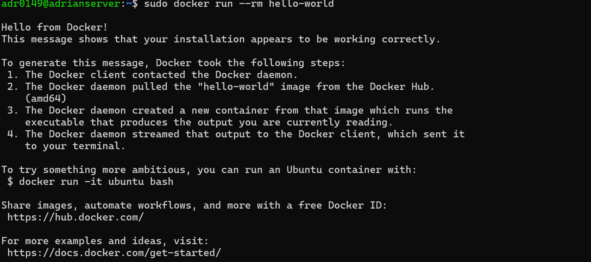
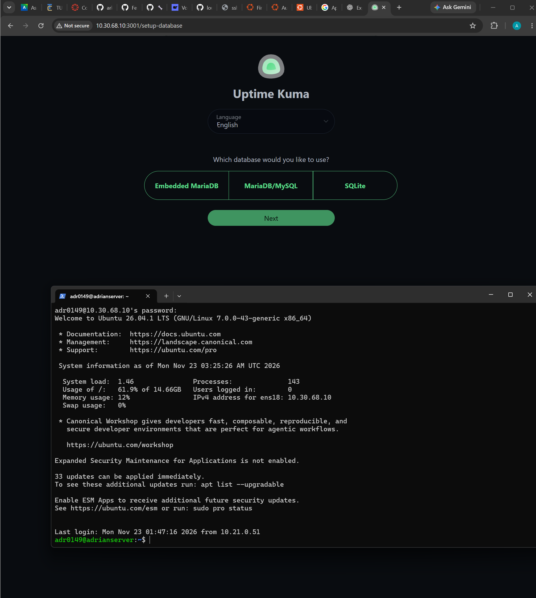
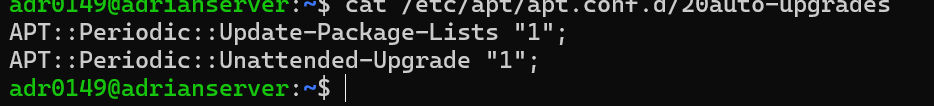
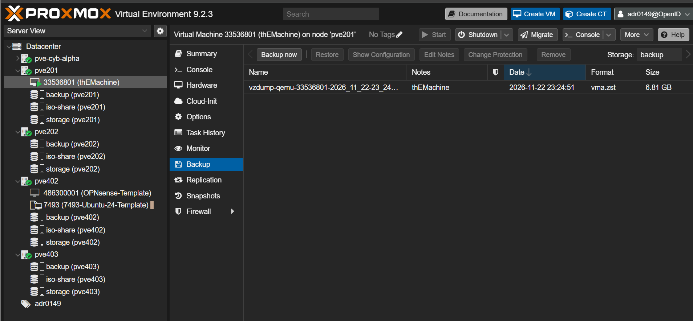
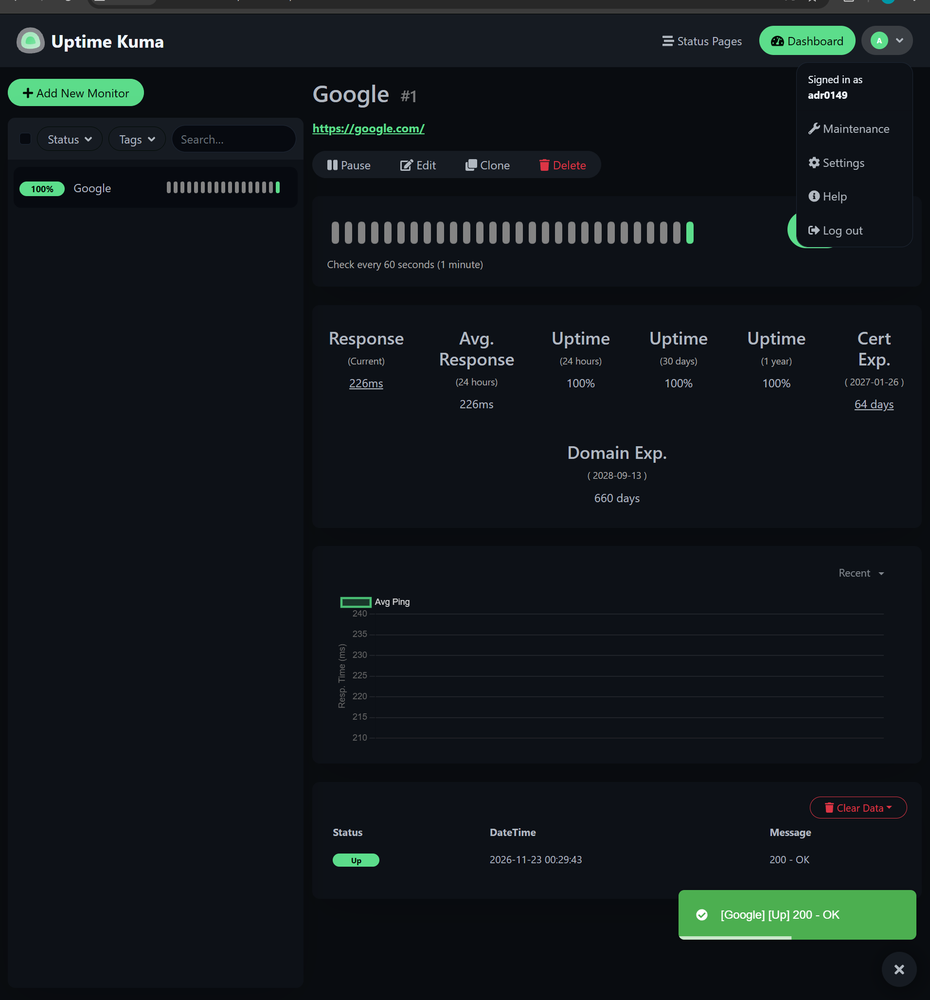
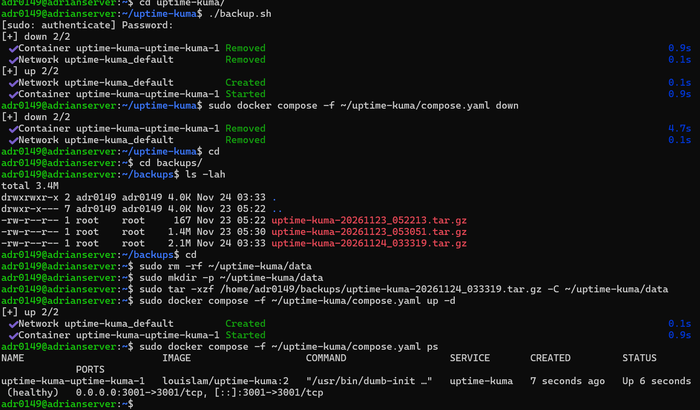
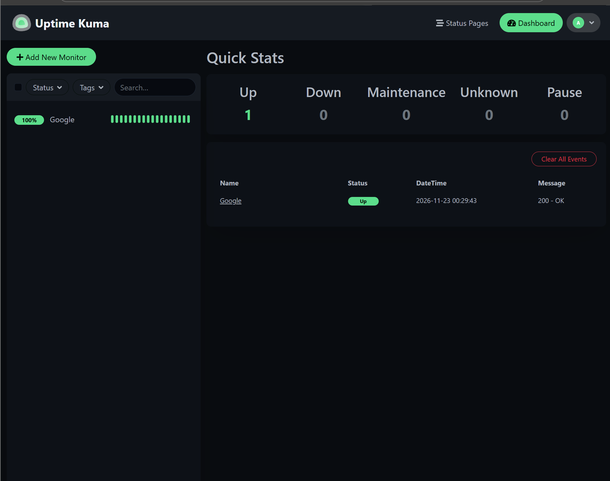

# Docker Compose Lab  
This guide goes over the main steps of deploying Uptime kuma on Ubuntu VM in Proxmox using Docker Compose, sedcuring the VM, setting up backups and lasyly running a recovery restore drill
## Step 1: *Taking a SnapShot Before Any Changes*  
So that nothing goes wrong with the setup process of Docker, it was wise for me to create a **snapshot.** 
The snapshot created was called: *Pre_Docker*




## Step 1.5: *SSH into Promox VM Thorugh my system*
To the process a little eaiser, I took the advice of friend and decided to connect to the VM through SHH. (I went through Powershell)

    ssh your_vm_user@your_vm_ip

## Step 2: *Application Docker Download*
### A. CD-ROM Source Issues Fix and Adding GPG Key for Docker

When trying to download docker there may be an error titled cdrom error. Apparently the reason for this error is due to `apt` initially trying to read from the local cdrom: source. The fix is to comment out that first line in `/etc/apt/sources.list`. Everything procedding this was installing `ca-certificates` and `curl`, and downloaded Docker's official GPG key.

```shell
sudo sed -i '1s/^/#/' /etc/apt/sources.list
```
—> Comments out the first line of the package source list so apt doesn't throw an error looking for the original installation CD

```shell
sudo apt update && sudo apt install -y ca-certificates curl
```
—> Refreshes the system's package list and installs curl and ca-certificates

```shell
sudo install -m 0755 -d /etc/apt/keyrings
```
—> Creates a dedicated folder to store trusted repository security keys.

```shell
sudo curl -fsSL https://download.docker.com/linux/ubuntu/gpg -o /etc/apt/keyrings/docker.asc
```
—> Downloads Docker's official GPG key into that folder so Ubuntu can verify that the Docker packages are authentic.

### B. Adding Docker Repository & Install Docker Engine

Next Step, add Docker's official Ubuntu repository to sources.

```shell
echo "deb [arch=$(dpkg --print-architecture) signed-by=/etc/apt/keyrings/docker.asc] \
https://download.docker.com/linux/ubuntu $(. /etc/os-release && echo $VERSION_CODENAME) stable" \
| sudo tee /etc/apt/sources.list.d/docker.list 
```
—> Adds Docker's official Ubuntu repository to APT's package sources

```shell
sudo apt update && sudo apt install -y docker-ce docker-ce-cli containerd.io docker-buildx-plugin docker-compose-plugin
```
—> Updates package indexes and installs Docker Engine, CLI, containerd, and the Docker Compose plugin

## Step 3: *Post Install Checks*
We want Docker to start automatically on reboot, thus the command below enables this and runs *hello-world* as a check.

```shell
sudo systemctl enable --now docker
```
-> Enables Docker to start on reboot automatically
```shell
systemctl is-enabled docker
```
->systemctl check to see if docker is enabled and start at boot
```shell
sudo docker run --rm hello-world
```
->Runs a test container that will verify if the Docker Engine is in working order. Example below of executed command:



```shell
docker compose version
```
-> Prints current installed Docker Version, final check to see if the plugin has installed correctly.

### Step 3: *Deployment of uptime kuma with Docker Compose*

    mkdir uptime-kuma
-> Creates Directory named **uptime-kuma**

    cd uptime-kuma

-> Cd or (Change Directory) into the the uptime-kuma

    curl -o compose.yaml https://raw.githubusercontent.com/louislam/uptime-kuma/master/compose.yaml

-> This command curls a github repository file `compse.yaml` and adds some configurations. The setup file contains:

```yaml
services:
  uptime-kuma:
    image: louislam/uptime-kuma:2
    container_name: uptime-kuma
    volumes:
      - uptime-kuma-data:/app/data
    ports:
      - "3001:3001"
    restart: unless-stopped

volumes:
  uptime-kuma-data:
```
--------------------------------
    docker compose up -d
-> Pulls image file for uptime-kuma and starts/creates a container it.

## Step 4: *Checks and Rebooting*


### A: *List the Containers*
Now that uptime-kuma is started in principle, its good practice  like anything to check something is working and on. Thus the following command is what I used to verification of Uptime Kuma.

    sudo docker compose ps
-> Lists active composed containers, which I use for verification.


### B: *Navigating to Webpage*
Within a broswer I looked up the following url to make sure the webpage is working.

    http://your_vm_ip:3001

Since I verified the page is up, just reboot the VM to verify survival on reboot.

    sudo reboot



-> The web page survived on reboot.

## Step 5: *Securing the VM* 

### A. SSH Key Authentication & Disable Password Logins

To not get get locked out after disabling passwords, I first generated an SSH key pair on my local machine using `GIT BASH`(Important!), copied the public key to the VM's `~/.ssh/authorized_keys` file. Finally verified key-based login passed in a 2nd terminal window that being a Powershell.

```shell
ssh-keygen -t ed25519
```
—> Creation of a new key pair using ed25519

```shell
ssh-copy-id your-user-id@your-vm's-ip
```
—> Copies the client's public SSH key into ~/.ssh/authorized_keys on the VM.

```shell
ssh your-user-id@your-vm's-ip
```

—> Tests logging into the VM using the SSH key in a separate terminal session before disabling password authentication. when its executes correctly, now I edit /etc/ssh/sshd_config to disable password authentication and reloaded the SSH service:

```shell
sudo nano /etc/ssh/sshd_config
```

—> Opens the SSH server configuration file , where I can set the line PasswordAuthentication to "no"

### Additional STEP:
Just changing the PasswordAuthentication to "no" is not enough, I had to do the same thing by editing an additional file with this command.

    sudo nano /etc/ssh/sshd_config.d/50-cloud-init.conf

This command allows nano in to edit PasswordAuthentication to "no" as well.


```shell
sudo systemctl reload ssh
```

—> Reloads the SSH daemon to apply key-only authentication without dropping active connection.

### B. Test Public-Key Authentication Disabled:

```shell
ssh -o PubkeyAuthentication=no your-user-id@your-vm's-ip
```
—> SSH login attempt without keys, this will verify if password authentication is refused.
### Terminals Output:

```shell
Permission denied (publickey)
```

### C. Setup UFW (Firewall) 

I allowed SSH (22/tcp) and Uptime Kuma (3001/tcp) and enabled the firewall. Then I checked its status to see if my changes were made.

```shell
sudo ufw allow 22/tcp && sudo ufw allow 3001/tcp && sudo ufw enable
```
—> Allows inbound SSH (22/tcp) and Uptime Kuma (3001/tcp) traffic and activates the firewall

```shell
sudo ufw status
```
—> Prints the active firewall rules confirming only ports 22 and 3001 are open

### Output:

```shell
To                         Action      From
--                         ------      ----
22/tcp                     ALLOW       Anywhere
3001/tcp                   ALLOW       Anywhere
22/tcp (v6)                ALLOW       Anywhere (v6)
3001/tcp (v6)              ALLOW       Anywhere (v6)
```

### D. Enable Automatic Security Updates
Finally, I installed and enabled unattended-upgrades so the server automatically installs security updates.

```shell
sudo apt install -y unattended-upgrades && sudo dpkg-reconfigure -plow unattended-upgrades
```
—> Installs the unattended-upgrades package and enables automatic daily security updates



## Step 5: *Set Up Volume Backups and Proxmox VM Backup*

### A. Create and Run the backup.sh Script

Having backups in case the volume/mount deletion is important, the bash script `backup.sh` is created for this purpose. The script stops the container, compresses the volume data directory into a timestamped .tar.gz archive in ~/backups, restarts the container, and deletes everything except the 7 newest archives.

### Creating the backup.sh Script:

```shell
nano backup.sh
```
— Nano's creates the backup.sh file to write into.

### backup.sh Script:
```shell
#!/bin/bash
set -e

mkdir -p "$HOME/backups"
TIMESTAMP=$(date +"%Y%m%d_%H%M%S")
VOLUME_PATH="$HOME/uptime-kuma/data"
sudo docker compose -f "$HOME/uptime-kuma/compose.yaml" down
sudo tar -czf "$HOME/backups/uptime-kuma-${TIMESTAMP}.tar.gz" -C "$VOLUME_PATH" .
sudo docker compose -f "$HOME/uptime-kuma/compose.yaml" up -d
ls -1t "$HOME/backups"/uptime-kuma-*.tar.gz | tail -n +8 | xargs -r rm -f
```
—> The script stops the container, compresses the mounted data directory into a timestamped .tar.gz archive in ~/backups, restarts the container.

Now I made the script executable, ran it multiple times, and checked ~/backups to verify archives were created:

```shell
chmod +x backup.sh
```
—> Grants execute permissions to backup.sh

```shell
./backup.sh
```
—> Runs the backup script to create a timestamped .tar.gz archive of the Uptime Kuma volume

```shell
ls -lh ~/backups
```
—> Lists the contents of ~/backups in human-readable data sizes to verify the archives exit.

Output:
```shell
total 116K
-rw-r--r-- 1 root root 36K Nov 22 03:58 uptime-kuma-20261122_035831.tar.gz
-rw-r--r-- 1 root root 36K Nov 22 03:58 uptime-kuma-20261122_035849.tar.gz
-rw-r--r-- 1 root root 42K Nov 22 04:16 uptime-kuma-20261122_041634.tar.gz
```
->Output is an example what it should look like.

### B. VM Backup in Proxmox

Another saftey meaure is setting a Backup tab for the VM in Proxmox.




## Step 6: *Disaster Recovery Restore Drill*

### A. Add a New Website to Monitor, Back It Up and Delete the Volume/Data Mount.

To check the working backup, I setup Uptime Kuma with a new monitor for google.com acting as a configuration to save.

Before deletion of Mounted directory + Google Monitor:




Next, to test with the recovery restore drill, I ran the backup.sh script, ran docker compose down and deleted the volume:

```shell
./backup.sh
```
—  Runs the backup script to save a backup 

```shell
sudo docker compose -f ~/uptime-kuma/compose.yaml down
```
— Stops and removes the running Uptime Kuma Xontainer

```shell
sudo rm -rf ~/uptime-kuma/data
```
— Permanently deletes the named Docker mounted directory

### B. Restore from the Backup Archive and Verify

To recover the data, I recreated an empty Docker volume/data mount with the same name, extracted the archived backup into its data directory, and started the container back up:

```shell
sudo mkdir -p ~/uptime-kuma/data
```
— Recreates an empty Docker Mount directory with the exact name expected by compose.yaml

```shell
sudo tar -xzf /home/adr0149/backups/uptime-kuma-20261124_033319.tar.gz -C ~/uptime-kuma/data
```
— Extracts one of the valid backup archive into the recreated data directory.

```shell
sudo docker compose -f ~/uptime-kuma/compose.yaml up -d
```
— Starts Uptime Kuma back up using the restored data.

After refreshing the webpage it's completely restored:

Entire setup with removing and bring back Uptime Kuma with backups:



After picture of Uptime Kuma:



### *Sources*

#### Docker Volumes
* [Docker Volumes Documentation (Official Docker Docs)](https://docs.docker.com/engine/storage/volumes/) — Information over how to set up persistent data storage, inspecting `/var/lib/docker/volumes/`, and volume backup/restore procedures.

#### Uptime Kuma Deployment
* [Uptime Kuma Installation Wiki (Official GitHub)](https://github.com/louislam/uptime-kuma/wiki/%F0%9F%94%A7-How-to-Install) — Used for deploying the `louislam/uptime-kuma:2` container image and mapping port `3001:3001`.

#### Linux VM Hardening (SSH, UFW and Automatic Updates)
* [OpenSSH `ssh-keygen` Manual](https://man.openbsd.org/ssh-keygen) — Information over key pairs and how to set them up.
* [Ubuntu Server Guide: Uncomplicated Firewall (UFW)](https://ubuntu.com/server/docs/firewalls) — Information on configuring `ufw`.
* [Ubuntu Server Guide: Automatic Updates (`unattended-upgrades`)](https://ubuntu.com/server/docs/how-to/software/automatic-updates/) — Used for installing and configuring `unattended-upgrades` to apply daily security patches.
* [APT `sources.list` Manual (`cdrom:` repository fix)](https://manpages.ubuntu.com/manpages/noble/man5/sources.list.5.html) — Helped with the cdrom problem when trying to install docker.

